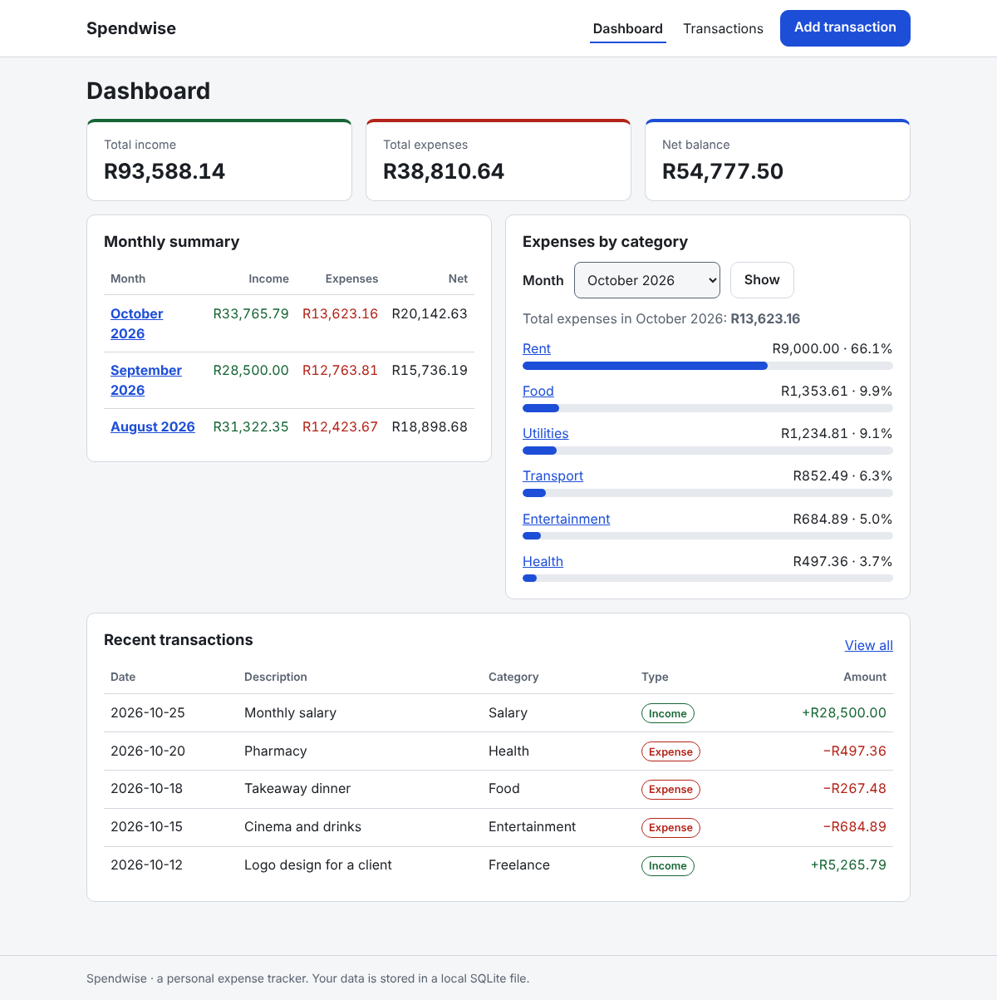
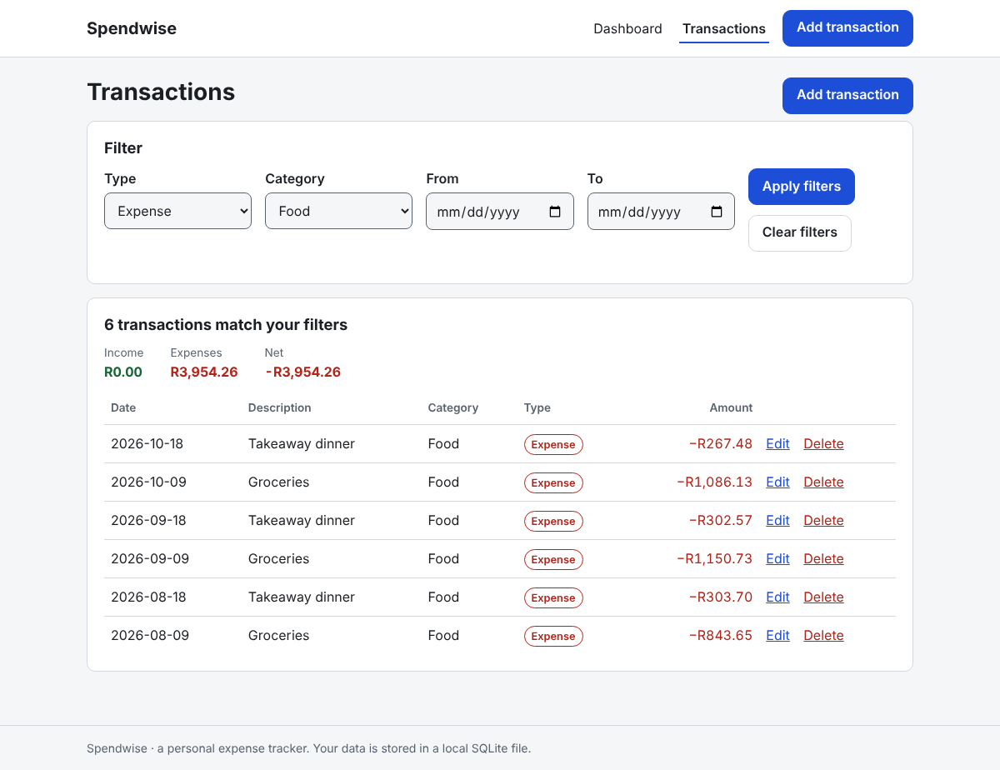
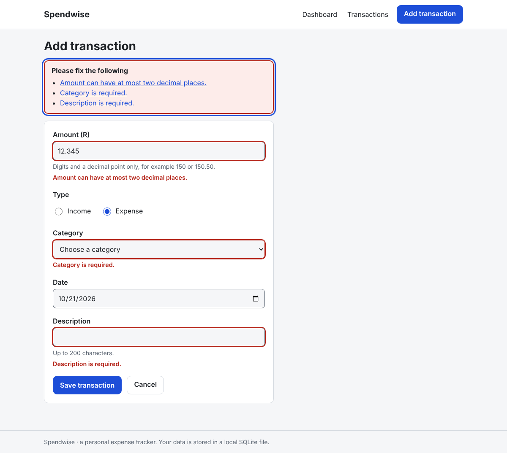
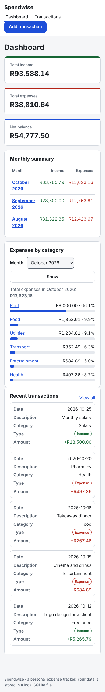
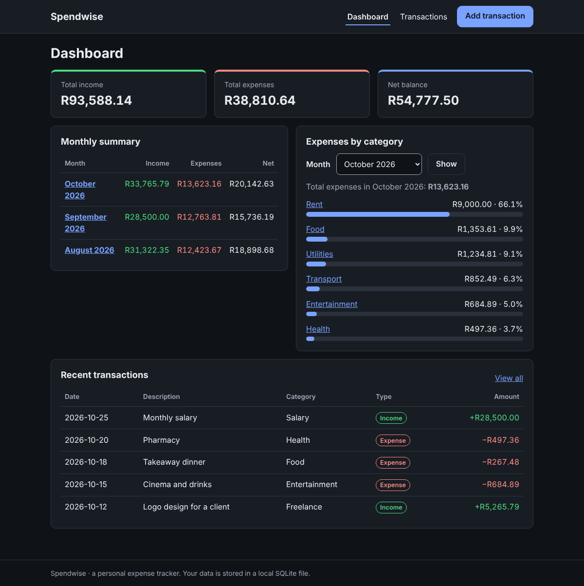

# Spendwise

A small personal expense tracker built with Flask and SQLite. You record income and
expenses, then see totals, a monthly summary and a category breakdown, all calculated from
the data in a local database file.

Spendwise is a learning and portfolio project. It is built to be simple, readable and
carefully tested, not to be a finished product. See [Known limitations](#known-limitations)
before using it for anything real.

## Screenshots

These were captured from the running application in headless Chromium, using
**fictional sample data** created only for the screenshots (the figures are made up).

| Dashboard | Filtered transaction list |
| --- | --- |
|  |  |

| Validation messages | Phone-width layout | Dark colour scheme |
| --- | --- | --- |
|  |  |  |

## Features

- **Dashboard:** total income, total expenses and net balance, a monthly summary table
  (income, expenses, net) and an expense breakdown by category for a month you choose.
- **Transactions:** add, edit and delete. Deleting is a `POST` that needs a confirmation page first.
- **Filters:** by type, category and date range. Filters are kept when you add, edit or
  delete and return to the list.
- **Separate category lists** for income and expenses (fixed lists, see
  [ARCHITECTURE.md](ARCHITECTURE.md)).
- **Validation with clear messages** for amount, type, category, date and description.
- **Money is exact:** amounts are stored as whole cents in the database. No floating-point
  numbers are used for money. Currency is shown as South African rand (R).
- **Responsive, restrained layout** with a light and a dark colour scheme that follows the
  browser setting, labelled form fields, and a focus-managed error summary.
- **Security basics:** CSRF tokens on every form, a safe-redirect allowlist, a content
  security policy and other response headers, a request size limit, and a secret key that
  must be set when running in production mode.

## Technology

| Part | Choice |
| --- | --- |
| Language | Python (tested on 3.11, 3.12 and 3.13) |
| Web framework | Flask 3.1.3 (Jinja2 templates) |
| Database | SQLite through Python's built-in `sqlite3`, plain SQL |
| Front end | Hand-written CSS and a small amount of vanilla JavaScript (optional, pages work without it) |
| Tests | pytest 9.1.1 |

There is no JavaScript framework, no ORM, no login system and no other runtime dependency.

## Installation summary

Full step-by-step instructions, including Windows PowerShell, are in [RUNNING.md](RUNNING.md).
The short version for Linux/macOS:

```bash
python3 -m venv .venv
source .venv/bin/activate
pip install -r requirements.txt
export SPENDWISE_ENV=development
flask --app app run
```

Then open <http://127.0.0.1:5000>. The database file is created automatically at
`instance/spendwise.sqlite` the first time the app starts.

## Running the tests

With the virtual environment active:

```bash
python -m pytest
```

The suite has 369 tests and takes about 15 seconds. It uses temporary databases, so it
never touches your real data. What the tests cover is explained in
[ARCHITECTURE.md](ARCHITECTURE.md#testing).

## Documentation

- [RUNNING.md](RUNNING.md): installing, configuring, starting and troubleshooting.
- [ARCHITECTURE.md](ARCHITECTURE.md): structure, request flow, layers, schema and design decisions.

## Known limitations

- **Not production-ready.** The documented way to run it is Flask's built-in development
  server. There is no deployment guide, no production web server setup and no HTTPS setup.
- **No authentication.** Anyone who can reach the running app can read and change all data.
  Run it only on your own machine or a network you trust.
- **Single currency and fixed categories.** South African rand only; the category lists are
  in code and cannot be edited in the app.
- **No data migrations.** The schema is created if missing. A future schema change would
  need a migration step that does not exist yet.
- **No import, export, backup tool, pagination or search.** The transaction list shows every
  matching row, and "search" means the filters above.
- **Local SQLite file.** Suitable for one person. It is not designed for many simultaneous users.
- **Limited manual testing.** The interface was viewed in headless Chromium on Linux only
  (desktop width, 390 px width, light and dark schemes). It was **not** tested in Firefox,
  Safari, Edge or on a real phone, **no screen reader or other assistive technology was
  used**, and the Windows instructions have not been run on a Windows computer. The page is
  built with labelled fields, headings and keyboard-reachable controls, but that is not the
  same as having tested it with assistive technology.
- **Narrow screens:** on a phone-width screen the "Net" column of the monthly summary table
  is off-screen, and the table scrolls sideways inside its card.
- **Security:** the CSRF protection and redirect checks are custom code with automated tests,
  but they have not been independently audited.

## Licence

No licence has been chosen yet. Until one is added, all rights are reserved by the author.
